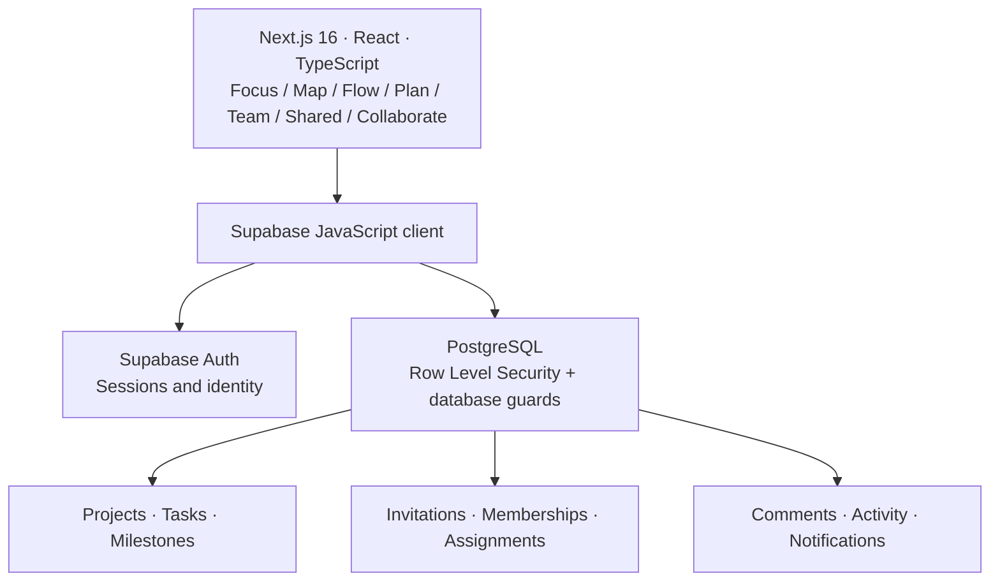

# TeamSpace

### Less chaos. More momentum.

**A collaborative workspace for the tasks in front of you, the projects around you, and the people working with you.**

[**Live Demo**](https://teamspace-teal.vercel.app) · [**Engineering Case Study**](docs/CASE_STUDY.md) · [**Source Code**](https://github.com/sewararashidi-byte/teamspace)

**Next.js 16 · TypeScript · React · Tailwind CSS · Supabase · PostgreSQL · Vercel**

---

## Why TeamSpace?

Project tools often make people navigate the same information through rows, counters, and dashboards. TeamSpace explores a different idea: **the right perspective should depend on what someone is trying to accomplish**.

The result is a full-stack project-management application with a distinct *Fieldnotes* interface, persistent task and milestone planning, and invitation-based collaboration. Its warm, editorial design puts the work itself ahead of dashboard decoration.

## A workspace with different perspectives

| Space | Purpose |
|:--|:--|
| **Focus** | Surface important work, priorities, and upcoming deadlines. |
| **Map** | Explore projects visually and understand their context. |
| **Flow** | Move through tasks using statuses, labels, deadlines, and filtering. |
| **Plan** | Organize milestones on a timeline and connect tasks to checkpoints. |
| **Team** | Invite collaborators, manage project memberships, and assign work. |
| **Shared** | View projects shared by other people. |
| **Collaborate** | Discuss tasks, review activity, edit permitted fields, and check notifications. |

### What it can do

- **Authenticated accounts:** registration, sign-in, email verification, password recovery, and sign-out through Supabase Auth.
- **Persistent workspaces:** create and organize projects and tasks with priorities, status, labels, and due dates.
- **Milestone roadmaps:** track target dates and connect tasks to project checkpoints.
- **Project invitations:** add collaborators through invitation-based membership.
- **Role-aware access:** project owners manage membership and assignments; editors can make permitted task updates; viewers can follow shared work without editing task details.
- **Task discussions:** comments, task activity records, and recipient-specific in-app notifications.
- **Responsive design:** a consistent Fieldnotes visual system across desktop and smaller screens.

## The experience

TeamSpace is organized around three everyday questions:

**What needs my attention?**  
Focus prioritizes the work that matters now.

**How does this work fit together?**  
Map and Plan reveal project context, task relationships, and upcoming checkpoints.

**How do we move it forward together?**  
Flow, Team, Shared, and Collaborate support progress and communication without flattening every interaction into a dashboard.

## Technical architecture

| Concern | Implementation |
|:--|:--|
| Application | Next.js App Router, React, TypeScript |
| Interface | Tailwind CSS, responsive Fieldnotes design |
| Authentication | Supabase Auth |
| Data | PostgreSQL through Supabase |
| Access control | PostgreSQL Row Level Security and database-side authorization checks |
| Hosting | Vercel |
| Source control | Git and GitHub |

### Collaboration and privacy

TeamSpace separates **project ownership** from **project membership**. Shared access is granted through invitations; viewer and editor experiences are constrained by role-aware permissions. Database policies and guards provide enforcement beyond what the interface shows.

During development, cross-account access was manually tested to check that unrelated users could not see private projects, viewers could not change core task fields, and removal of membership revoked shared access. This is a portfolio application, **not a claim of a formal security audit**.

## Engineering highlights

**Multiple views, one underlying model.** Focus, Map, Flow, and Plan present related project data without duplicating separate sources of truth.

**Incremental data evolution.** Deadlines, milestones, invitations, and collaboration were introduced in stages while preserving existing tasks and projects.

**Authorization at the data layer.** Membership rules, role-aware task updates, comments, and notification ownership are checked with PostgreSQL policies and database-side logic.

**Production readiness checks.** The application passed ESLint, TypeScript, and an optimized Next.js build; its core authentication and collaborative workflows were manually tested on the deployed site.

A more detailed account of the product decisions, challenges, and trade-offs is available in the [engineering case study](docs/CASE_STUDY.md).

## Live demo

**[Open TeamSpace →](https://teamspace-teal.vercel.app)**

The live deployment is the interactive demo. Authentication is required to work with projects; shared-project experiences are available to invited members. No separate demo video or shared test credentials are required to explore an individual workspace.

## Current scope

The deployed application includes its core planning and collaboration workflows. In-app notifications are fetched in the application; **instant real-time updates, email/push alerts, file attachments, and a full automated test suite are not part of this release**. Further work could add repeatable integration tests, accessibility improvements, and live subscriptions.

## About the developer

**Sewara Rashidi** · Software Engineering

[GitHub](https://github.com/sewararashidi-byte) · [LinkedIn](https://www.linkedin.com/in/sewara-rashidi-409070383)

---

Designed and developed as a full-stack software engineering portfolio project.

